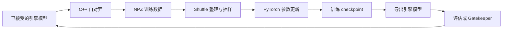

# KataGo 本地训练资料汇总

检索日期：2026-10-12，Asia/Shanghai。面向目标：先在 RTX 5070 Laptop 上跑通训练，再继续训练现有权重，随后实验网络结构修改，并考虑迁移到云端 40/50 系 GPU。

这份资料包由官方文档、实际训练源码、公开模型与数据档案、作者实验说明及少量社区候选教程组成。配套的 [资料索引](./资料索引.md) 收录 48 个入口，并标记用途与核对程度。实现细节以保存的官方源码为准。

## 1. 目前最适合你的路线

建议按以下次序推进。这是结合你的目标与显存给出的工程判断，尚未在本机进行训练实测。

1. **离线训练验证**：少量官方 NPZ 数据 → 一个小网络或一个兼容的现有 PyTorch checkpoint → 少量梯度更新 → 保存 checkpoint → 导出 → C++ 引擎加载。
2. **单机自对弈闭环**：在同一张卡上依次执行自对弈、数据整理、训练、导出与评估，先确认新模型能重新参与生成数据。
3. **继续训练现有模型**：先保持原有网络结构与输入输出约定，建立固定的评估基线，再改变训练数据、学习率或优化器。
4. **修改网络结构**：先选择官方已有模块与可导出的配置；需要改变权重张量形状时，单独设计迁移，或训练较小的学生模型。
5. **云端扩大实验**：迁移同一代码版本、数据格式、checkpoint 和评估流程，再根据实测调整批量大小与自对弈吞吐。

第一步可以利用 [官方 NPZ 档案](https://katagoarchive.org/kata1/trainingdata/index.html) 和 [Raw Checkpoint 下载页面](https://katagotraining.org/networks/)。第二步有 [官方单机同步脚本](https://github.com/lightvector/KataGo/blob/master/python/selfplay/synchronous_loop.sh) 可以参考。

本机通过 `nvidia-smi` 读到：`NVIDIA GeForce RTX 5070 Laptop GPU`、显存 `8151 MiB`、驱动 `581.83`。约 8 GB 显存适合从小规模实验开始。内存、剩余 SSD 空间、笔记本 TGP 和长期运行温度尚未纳入评估，因此这里不承诺 batch 大小或训练时间。

## 2. 先把几种“训练”分清楚

| 路线 | 实际做什么 | 与你当前目标的关系 |
|---|---|---|
| 引擎推理与分析 | 加载 `.bin.gz` 下棋、复盘、输出胜率 | 是导出后的验证环节 |
| `contribute` 公共训练贡献 | 本机生成对局并上传到官方服务器 | 可以参与官方项目；不会自动建立你自己的参数更新流程 |
| 离线训练 | 读取已有 NPZ，更新你自己的模型参数 | 最方便定位模型加载、反向传播、保存与导出问题 |
| 本地自对弈强化学习 | 用自己的模型生成数据，再训练并循环 | 适合第二阶段跑完整流程 |
| 从现有 checkpoint 继续训练 | 保持或迁移已有模型参数，使用自己的数据更新 | 你的主要目标之一 |
| 人类 SGF 监督学习 | 预测人类落子等目标，需要相应标签与元信息 | 适合模仿棋风、段位；与追求最强自对弈棋力的目标不同 |
| 网络结构研究 | 改通道、块数、模块、输出头等 | 需要额外处理权重迁移和推理接口 |

公共贡献的运行方式见 [官方训练网站](https://katagotraining.org/)；训练脚本与辅助工具的角色见 [Python 源码导读](https://github.com/lightvector/KataGo/blob/master/python/README.md)。

## 3. 版本现状，以及教程里的滞后信息

检索时，KataGo 的 GitHub `releases/latest` 指向 [v1.18.2](https://github.com/lightvector/KataGo/releases/tag/v1.18.2)。该版本主要优化 CUDA 后端；发布说明引导其他后端用户查阅 v1.18.1。

[v1.17.0 发布说明](https://github.com/lightvector/KataGo/releases/tag/v1.17.0) 引入正式的 Transformer 引擎支持。[训练网站公告](https://katagotraining.org/) 显示，公共贡献已在 2026-09-15 停止支持 v1.18.0 以前的版本。这个限制针对公共服务器贡献；本地实验要自行保证代码、数据与模型格式匹配。

当前官方训练代码使用 **PyTorch**。网上仍能搜索到 TensorFlow 1.15、TFRecord、SavedModel 的旧流程，它们通常对应旧代码版本。复现历史实验时可以研究旧路线；新实验应围绕选定的 PyTorch 源码版本搭建。

本轮直接读取并保存了官方 `master` 的部分文本文件，固定在 commit：

```text
d91ea855110dae533f0aada947b2b7d78cc8a4e1
```

这是供研究追溯的开发分支快照，不能将它与 v1.18.2 的源代码视作完全相同。后续部署需选择一个版本，围绕该版本完成端到端验证。

发现的文档与源码差异：

| 项目 | 部分官方说明中的名称 | 本轮源码快照中的实际名称 |
|---|---|---|
| 导出程序 | `python/export_model.py` | `python/export_model_pytorch.py` |
| 待导出的训练模型目录 | `tfsavedmodels_toexport` | `torchmodels_toexport` |
| 额外模型待导出目录 | `tfsavedmodels_toexport_extra` | `torchmodels_toexport_extra` |

这些结论来自 [train.sh](https://github.com/lightvector/KataGo/blob/d91ea855110dae533f0aada947b2b7d78cc8a4e1/python/selfplay/train.sh)、[导出包装脚本](https://github.com/lightvector/KataGo/blob/d91ea855110dae533f0aada947b2b7d78cc8a4e1/python/selfplay/export_model_for_selfplay.sh) 和 [实际导出源码](https://github.com/lightvector/KataGo/blob/d91ea855110dae533f0aada947b2b7d78cc8a4e1/python/export_model_pytorch.py)。

## 4. 训练闭环如何工作



| 环节 | 入口 | 需要关注的产物 |
|---|---|---|
| 生成数据 | `cpp/katago selfplay` | SGF、`tdata` 下的 NPZ、统计日志 |
| 整理数据 | `python/shuffle.py` / `selfplay/shuffle.sh` | 训练窗口、抽样、打乱后的文件 |
| 参数更新 | `python/train.py` / `selfplay/train.sh` | `checkpoint.ckpt`、损失与训练状态 |
| 导出 | `python/export_model_pytorch.py` | 引擎格式 `model.bin`；包装脚本随后 gzip |
| 接受模型 | `cpp/katago gatekeeper` 或直接接受 | 进入 `models` 的新模型 |

完整设计见 [SelfplayTraining.md](https://github.com/lightvector/KataGo/blob/master/SelfplayTraining.md)。同步脚本按阶段运行；官方大规模运行通常采用各阶段同时工作的异步方式。

对单张 8 GB GPU，先使用顺序执行便于控制显存，也便于测出每阶段耗时。进入云端多卡阶段后，再考虑把自对弈与训练分开。

官方给出的经验是：自对弈通常应消耗比参数训练更多的 GPU 算力，推荐范围为约 4–40 倍。这是资源分配经验，不能直接当成本机速度预测；离线训练阶段也不适用这个比例。[来源](https://github.com/lightvector/KataGo/blob/master/SelfplayTraining.md)

## 5. 现有权重继续训练：最关键的文件与加载规则

### 5.1 下载什么

[官方模型列表](https://katagotraining.org/networks/) 的同一行通常提供两个入口：

| 入口 | 用途 |
|---|---|
| Network File | C++ 引擎用的 `.bin.gz` |
| Raw Checkpoint | 原始训练权重包，继续训练应从这里开始 |

本轮确认 `kata1-tf2-b10c384-s2941M-d5872M` 的 Raw Checkpoint 链接指向 `.zip`。没有下载或解压模型包，因此未验证包内完整文件清单。选择模型后需要检查里面的 checkpoint、配置和训练状态。

这里的 `tf2`、`tf3` 在当前官方架构表中是 Transformer 系列的短名称，不能仅根据名字判断为 TensorFlow 文件。[NetworkArchitectures.md](https://github.com/lightvector/KataGo/blob/master/docs/NetworkArchitectures.md)

### 5.2 当前训练入口

本轮 `train.py` 提供 `-initial-checkpoint`。加载规则如下：

1. 训练目录已有 `checkpoint.ckpt` 时，通常优先恢复它。
2. 没有已有 checkpoint 时，才使用 `-initial-checkpoint` 指定的文件。
3. 加载的 checkpoint 包含 `config` 时，优先按照其中的网络配置建立模型。
4. 随后加载对应参数；不能靠改变命令行中的网络名称自动完成形状迁移。

这是直接核对 [train.py 的加载逻辑](https://github.com/lightvector/KataGo/blob/d91ea855110dae533f0aada947b2b7d78cc8a4e1/python/train.py#L887) 得出的结论。

因此，为一个新实验建立新的训练目录，能避免意外恢复旧实验。要将 b18 变成 b28，或改变通道数，需要显式转换 checkpoint 与配置，或建立新模型；只改 `-model-kind` 并不会完成这件事。

### 5.3 训练状态也会影响行为

公开发布的 checkpoint 可能经过清理，不包含优化器状态。官方 [clean_checkpoint.py](https://github.com/lightvector/KataGo/blob/d91ea855110dae533f0aada947b2b7d78cc8a4e1/python/clean_checkpoint.py) 会移除优化器和若干与原运行有关的字段，同时保留部分训练状态。

所以“从官方权重继续训练”和“精确恢复官方原训练任务”不是同一件事。检查学习率所依赖的样本计数、优化器、训练 bucket、SWA，以及新运行的导出配置。当前源码允许在缺少优化器状态时构造新优化器，但是否适合实验目标仍需评估。

[edit_checkpoint.py](https://github.com/lightvector/KataGo/blob/d91ea855110dae533f0aada947b2b7d78cc8a4e1/python/edit_checkpoint.py) 可用于查看状态信息。开始时只查看即可；修改字段前先保留原始文件副本。

### 5.4 建议先完成的验证

按同一模型配置读取 checkpoint，检查一次前向计算；做少量更新并保存；从保存结果重新加载；导出；让 C++ 引擎加载并完成对局；最后确认后续自对弈确实读到了新模型。这个顺序能将加载、训练、序列化、导出和对局问题分别定位。

## 6. 可用的数据来源

### 6.1 官方 NPZ 数据

[katagoarchive.org](https://katagoarchive.org/) 提供 g65、g104、g170 和 kata1 档案。对当前流程，优先查看 [kata1/trainingdata](https://katagoarchive.org/kata1/trainingdata/index.html)。目录按日期提供压缩包；不需要为试跑下载全部历史数据。

档案 [README](https://katagoarchive.org/kata1/README.txt) 解释了 SGF 与 NPZ 的区别：SGF 主要便于人阅读，所含训练信息只是完整训练目标的一部分。需要参数更新时，优先使用训练 NPZ。

| NPZ 字段 | 含义概览 |
|---|---|
| `binaryInputNCHWPacked` | 压缩的棋盘空间输入特征 |
| `globalInputNC` | 规则、贴目、历史等全局输入 |
| `policyTargetsNCMove` | 落子策略目标 |
| `globalTargetsNC` | 胜负、分数、权重、元信息等 |
| `scoreDistrN` | 分数分布目标 |
| `valueTargetsNCHW` | 归属和其他空间预测目标 |

精确含义以 [trainingwrite.h](https://github.com/lightvector/KataGo/blob/d91ea855110dae533f0aada947b2b7d78cc8a4e1/cpp/dataio/trainingwrite.h) 与 [数据读取源码](https://github.com/lightvector/KataGo/blob/d91ea855110dae533f0aada947b2b7d78cc8a4e1/python/katago/train/data_processing_pytorch.py) 为准。较新数据还可能包含 Q-value 等字段。

当前读取代码包含旧 `globalTargetsNC` 的补齐逻辑。它提供了部分历史格式兼容处理，仍应抽样验证实际文件的键、形状、棋盘缓冲长度和目标权重。

### 6.2 自己生成数据

`selfplay` 可以直接生成训练文件。要针对某类局面研究，可参考 `selfplay1.cfg` 中的 SGF 起始局面与 hint 局面选项。它们可以让模型从指定局面继续对弈并构造训练目标，不等同于直接把 SGF 当完整训练张量。[配置源码](https://github.com/lightvector/KataGo/blob/d91ea855110dae533f0aada947b2b7d78cc8a4e1/cpp/configs/training/selfplay1.cfg)

### 6.3 人类 SGF 监督训练

官方存在 [writetrainingdata.cpp](https://github.com/lightvector/KataGo/blob/d91ea855110dae533f0aada947b2b7d78cc8a4e1/cpp/command/writetrainingdata.cpp)，用于从 SGF 生成训练数据；它含数据源、玩家筛选、机器人标记等专门参数，部署时应核对该命令帮助。

[Issue #649](https://github.com/lightvector/KataGo/issues/649) 中，作者解释了策略、价值、分数、归属等目标需要合理构造。该讨论发表于 2022 年，适合了解问题；不要直接把当年的 TensorFlow 说明当成当前环境。

训练“模仿某类人类”的目标与训练“搜索后最强走法”的目标会影响标签构造。你的第一轮可以先用官方自对弈数据，待流程稳定后再引入定制 SGF。

## 7. RTX 5070 Laptop 的环境路线

### 7.1 倾向于 WSL2 + Ubuntu

我的建议是先评估 WSL2 中的 Linux 环境。理由是官方训练包装脚本采用 Bash，后续迁移云端 Linux 也能继续使用相近的目录与命令。

Windows 原生也可以编译引擎，官方 [Compiling.md](https://github.com/lightvector/KataGo/blob/master/Compiling.md) 有 MSVC 与 MinGW 说明。不过训练流程还要处理 Bash 脚本、依赖和路径约定，整体选择应以首次跑通为目标。

[NVIDIA CUDA on WSL 指南](https://docs.nvidia.com/cuda/wsl-user-guide/index.html) 明确说明 WSL2 使用 Windows 主机驱动映射的 CUDA 驱动接口。按该路线部署时，参考其 Toolkit 安装方式，避免安装会替换它的 Linux 显卡驱动包。

[Microsoft 文件系统指南](https://learn.microsoft.com/en-us/windows/wsl/filesystems) 建议，在 Linux 命令行工作时将频繁访问的文件放在 WSL Linux 文件系统。后续训练数据和 shuffle 临时文件可考虑放在 Linux 文件系统中，Windows 项目目录保存研究材料与同步副本。

### 7.2 RTX 50 系需要核对 Blackwell 支持

[PyTorch 2.7 发布说明](https://pytorch.org/blog/pytorch-2-7/) 首次宣布 Blackwell 支持与 CUDA 12.8 wheel。它说明了为什么不能随意套用旧 `cu118` 教程，但不是对当前最佳版本的结论。

[PyTorch 2.12 发布说明](https://pytorch.org/blog/pytorch-2-12-release-blog/) 又指出 CUDA 12.8 wheel 被弃用，新 GPU 用户应选 CUDA 13.0+ 构建，并核对驱动。检索时 [PyTorch 最新 release](https://github.com/pytorch/pytorch/releases/tag/v2.14.1) 为 2.14.1；部分安装页面展示的版本仍有滞后。

因此部署时应明确选定 **PyTorch 版本、wheel 的 CUDA 版本、驱动兼容条件**，再进行实际 CUDA 计算与反向传播验证。仅看到 `torch.cuda.is_available()` 为真，还不足以确认所选训练代码可运行。

### 7.3 C++ 引擎与 PyTorch 是两套依赖

PyTorch 用来更新参数；C++ 引擎后端用来执行自对弈搜索与推理。安装 GPU 版 PyTorch，不会自动完成 C++ 引擎编译需要的所有依赖。

对 NVIDIA GPU，优先比较 CUDA/cuDNN 与 TensorRT 后端。v1.18.2 的说明建议 Transformer 使用较新的 cuDNN，并指出 TensorRT 不支持 10 以前的版本；具体性能仍取决于网络与 GPU。[发布说明](https://github.com/lightvector/KataGo/releases/tag/v1.18.2)

编译时还有一个与训练直接相关的依赖：**libzip**。官方文档将它列为自对弈写训练数据需要的组件；一个能分析棋局的可执行文件，未必包含完整训练数据写出能力。Linux 的长期多线程自对弈还应阅读 TCMalloc 的说明。[Compiling.md](https://github.com/lightvector/KataGo/blob/master/Compiling.md)

## 8. 网络选择与显存判断

下表的参数量来自 [官方架构文档](https://github.com/lightvector/KataGo/blob/master/docs/NetworkArchitectures.md)，按引擎导出的模型统计，可能不包含全部训练辅助头。用途列是针对你当前目标的建议。

| 网络 | 约参数量 | 建议用途 |
|---|---:|---|
| `b6c96` | 1.03 M | 新建小模型，验证训练与导出链路 |
| `b10c128` | 2.99 M | 小模型实验与基础结构研究 |
| `tf2-b10c384` | 10.55 M | 现有 PyTorch Transformer checkpoint 的候选，先测小 batch |
| `b18c384nbt` | 26.33 M | 继续训练卷积/nested bottleneck 网络的候选 |
| `tf3-b10c512` | 28.54 M | 流程稳定后的另一种架构候选 |
| `b28c512nbt` | 72.83 M | 更适合在显存更宽裕时评估 |
| `tf3-b11c768` | 70.44 M | 近期主训练系列；不作为第一轮默认模型 |
| `b40c768nbt` | 232.53 M | 大模型研究，优先留到云端评估 |

注意：旧小网络的公开 Raw Checkpoint 可能来自历史 TensorFlow 流程。使用 `b6c96` 作为新建模型配置，不等于其所有历史权重都能由当前 PyTorch 直接加载。

训练显存还包括梯度、优化器状态、激活、SWA、编译和临时缓冲，所以不能只用 `.bin.gz` 文件大小估算。

建议通过 [benchmark_fresh_model.py](https://github.com/lightvector/KataGo/blob/d91ea855110dae533f0aada947b2b7d78cc8a4e1/python/benchmark_fresh_model.py) 依次测 batch 1、2、4、8，再根据余量继续增加。第一轮使用 `-no-compile` 有助于减少初始化变量；流程稳定后再比较编译优化。当前脚本同时提供 FP16 与 BF16 相关选项，各脚本的参数名称并不完全相同。

## 9. 默认同步脚本需要调整的内容

本轮 [synchronous_loop.sh](https://github.com/lightvector/KataGo/blob/d91ea855110dae533f0aada947b2b7d78cc8a4e1/python/selfplay/synchronous_loop.sh) 的默认值包括：

| 参数 | 默认值 | 对本机试跑的影响 |
|---|---:|---|
| 每循环自对弈局数 | 500 | 首次调试可能等待较久 |
| Shuffle 进程数 | 8 | 需结合 CPU 与内存 |
| 每 epoch 训练样本量 | 100000 | 不是普通监督学习意义上的遍历全部数据一次 |
| 每条新数据允许的平均训练量 | 8 | 需要与数据供给相匹配 |
| Batch | 128 | 大模型可能超出本机显存 |
| 最初 Shuffle 门槛 | 100000 行 | 少量试跑数据可能尚不够开始训练 |
| 每循环最多训练量 | 500000 样本 | 可先减小以缩短验证周期 |
| Shuffle 抽样目标 | 600000 行 | 要与实际数据量和训练窗口配合 |

官方说明默认同步参数主要方便初期设置，未像主训练运行参数那样充分验证，不能当成所有硬件的最优配置。

`selfplay1.cfg` 还默认设置 128 个并行游戏、600 次主要搜索访问、100 次廉价搜索访问。降低主要 visits 时，也要一起核对 cheap search、reduced visits 与训练权重，避免参数比例失去意义。[配置源码](https://github.com/lightvector/KataGo/blob/d91ea855110dae533f0aada947b2b7d78cc8a4e1/cpp/configs/training/selfplay1.cfg)

9×9 可以缩短生成对局的时间。不过当前数据缓冲为 `dataBoardLen = 19`，`train.sh` 也传入 `-pos-len 19`。若希望同时缩小训练张量，需要匹配修改两边，并保证输入数据长度一致。9×9 实际棋盘与 19×19 缓冲张量不是同一概念；不同缓冲长度的数据不能直接混在同一 Shuffle 中。

对你的第一轮，我倾向于先保持 19 的数据缓冲，以便读取官方数据，使用小网络和少量更新；随后再建立单独的 9×9 实验目录。

## 10. 网络结构修改的不同难度

| 改动 | 现有参数的处理 | 导出与引擎需要考虑什么 |
|---|---|---|
| 学习率、优化器、数据比例 | 网络形状可以保持 | 一般沿用模型接口；用评估确认效果 |
| 采用官方支持的激活/归一化配置 | 有时张量形状相同，有时增加参数 | 需要核对完整配置与导出支持，函数行为也可能变化 |
| 增加通道数 | 原参数形状变化，需要迁移 | 官方有有限的扩通道脚本 |
| 增加或减少块数 | 需要匹配层与初始化新增参数 | 需要设计迁移，或重新训练/蒸馏 |
| 卷积网转换为 Transformer | 结构差异大，不能直接一对一加载 | 可以参考官方现有 Transformer 配置；考虑学生模型路线 |
| 新增辅助训练输出头 | 需要标签、损失与参数 | 可能只在训练时使用；仍要明确导出处理 |
| 修改策略/价值等引擎输出 | 需要重新定义目标与接口 | 需与模型格式、元数据和引擎消费方式保持一致 |
| 自定义新的运算模块 | 只能迁移可兼容的部分 | 需要导出路径与后端支持 |

优先阅读 [modelconfigs.py](https://github.com/lightvector/KataGo/blob/d91ea855110dae533f0aada947b2b7d78cc8a4e1/python/katago/train/modelconfigs.py)、[model_pytorch.py](https://github.com/lightvector/KataGo/blob/d91ea855110dae533f0aada947b2b7d78cc8a4e1/python/katago/train/model_pytorch.py)、[metrics_pytorch.py](https://github.com/lightvector/KataGo/blob/d91ea855110dae533f0aada947b2b7d78cc8a4e1/python/katago/train/metrics_pytorch.py) 和 [export_model_pytorch.py](https://github.com/lightvector/KataGo/blob/d91ea855110dae533f0aada947b2b7d78cc8a4e1/python/export_model_pytorch.py)。

### 10.1 官方扩通道脚本

[migrate_expand_channels.py](https://github.com/lightvector/KataGo/blob/d91ea855110dae533f0aada947b2b7d78cc8a4e1/python/migrate_expand_channels.py) 的说明限定为相同块数与块配置下扩大通道。代码按已知参数名称进行转换，未实现的情况会报错；它不保证支持任意新架构。

该脚本还会删除旧优化器状态与 SWA 状态。这属于一次参数迁移，后续要重新评估输出、训练稳定性与棋力，不能视为无损地原样恢复训练。

### 10.2 自定义架构的 ONNX 路线

当前 [ONNX 模型文件文档](https://github.com/lightvector/KataGo/blob/d91ea855110dae533f0aada947b2b7d78cc8a4e1/docs/ONNX_Model_Files.md) 描述了 TensorRT/ONNX 后端直接加载 ONNX 图的能力。这给自定义结构提供了另一条研究路径，但图需要满足 KataGo 输入输出与 `katago.*` 元数据约定。

普通 `torch.onnx.export` 生成的任意网络图不能据此认定可直接使用。具体 TensorRT 或 ONNX Runtime 对运算的支持，也要单独验证。

### 10.3 结构研究的实验设计

先保存一个固定数据集和原模型基线，每次只改变一类结构因素。对同一组棋盘、规则与贴目，比较 Python 模型和导出模型的原始输出，再运行固定条件对局。这样可以区分导出问题和训练效果。

## 11. 可供后续参考的命令形状

以下命令仅用于说明入口与参数关系，**本轮未执行**。路径为 Linux 占位路径，必须先具备完整源码环境、依赖、兼容数据与模型。真实部署还需要检查训练状态和所选版本的 `-help`。

### 11.1 测小网络的训练吞吐

```bash
cd /path/to/KataGo/python
python benchmark_fresh_model.py \
  -model-kind b6c96 \
  -batch-size 8 \
  -data /path/to/sample.npz \
  -mode trainloop \
  -use-amp \
  -no-compile
```

这个脚本的 `-use-amp` 用于训练 benchmark；`-use-fp16` 在该脚本中是仅前向推理的模型转换选项。不要把它与 `train.py` 同名参数的用途混为一谈。[源码](https://github.com/lightvector/KataGo/blob/d91ea855110dae533f0aada947b2b7d78cc8a4e1/python/benchmark_fresh_model.py)

### 11.2 从现有 checkpoint 做有限训练

```bash
python train.py \
  -traindir /path/to/new_experiment/train \
  -datadir /path/to/shuffled_data \
  -initial-checkpoint /path/to/pretrained/model.ckpt \
  -pos-len 19 \
  -batch-size 4 \
  -samples-per-epoch 512 \
  -sub-epochs 1 \
  -max-epochs-this-instance 1 \
  -lr-scale 0.05 \
  -use-fp16 \
  -no-compile
```

`shuffled_data` 应按训练器预期包含训练/验证子目录。512 样本、batch 4 和学习率缩放 0.05 是演示用的试跑数值，不是官方对现有模型的最优微调配方，也没有据此保证显存足够或模型变强。此处没有通过 `-model-kind` 声称改变已有 checkpoint 的结构。

### 11.3 手动导出用于加载验证

```bash
python export_model_pytorch.py \
  -checkpoint /path/to/new_experiment/train/checkpoint.ckpt \
  -export-dir /path/to/new_experiment/exported \
  -model-name local-smoke \
  -filename-prefix model
```

手动导出产物包含 `model.bin`；自对弈导出包装脚本随后压缩为 `.bin.gz`。只有 checkpoint 存在 SWA 权重时才加 `-use-swa`，否则官方加载器会报错。

### 11.4 同步循环入口

```bash
cd /path/to/KataGo/python
bash selfplay/synchronous_loop.sh \
  localrun /path/to/run smoke b6c96 0
```

这只是五个位置参数的形状。使用前应编辑循环参数，并提供正确位置的 C++ 可执行文件和配置。当前脚本没有把额外参数统一传入 `train.sh`，所以从预训练 checkpoint 启动或选择训练精度时，需要修改脚本的训练调用，或自行逐阶段调用。

还需先对照脚本的首次目录初始化：当前源码会调用一次 Gatekeeper，即使导出选择不 gating，首次运行也应检查有关目录与配置是否齐全。

## 12. 如何判断“跑通”和“变强”

| 层级 | 应观察的证据 |
|---|---|
| 数据可用 | NPZ 字段、形状与缓冲长度符合训练器预期 |
| 参数可更新 | 有限损失、梯度、参数更新与保存日志 |
| 可恢复 | 从保存的 checkpoint 继续少量训练成功 |
| 可导出 | 导出程序完成，C++ 引擎成功加载 |
| 可对弈 | 一盘对局完成，规则和结果合理 |
| 闭环成立 | 新导出的模型成为后续自对弈使用的模型 |
| 可能有棋力收益 | 固定条件对局有改善，且样本量与不确定性足够解释结果 |

降低训练损失并不能单独证明棋力提升。对局评估需要固定棋盘、规则、贴目、访问次数或用时，交换先后手，并避免只使用训练中反复出现的局面。

比较不同大小的网络时，要区分等 visits 与等用时：前者使单次评估更贵的网络消耗更多算力。官方模型页也对 Elo 的内部尺度和近似性作了说明。[模型页](https://katagotraining.org/networks/)

## 13. 有参考价值的原始实验与社区资料

| 资料 | 能学到什么 | 采用方式 |
|---|---|---|
| [官方 9×9 Opening Books](https://katagobooks.org/) | 作者从现有强模型做小棋盘专项微调的经验 | 可支持“小棋盘 + 预训练模型”这条研究路线；不是一键教程 |
| [KataGomo training.md](https://github.com/hzyhhzy/KataGomo/blob/master/training.md) | 作者实际使用的训练脚本与参数关系 | 项目用于多种棋类及变体，移植围棋流程时核对分支与接口 |
| [自定义模型发布记录](https://douletmedia.me/Kata_web/release/s10784990976-d120396/) | 从 b28 checkpoint 启动的训练命令示例 | 作者自行报告的结果；本轮未复现，样本量文字与名称计数有不一致 |
| [Issue #649](https://github.com/lightvector/KataGo/issues/649) | SGF 标签构造与辅助目标的考虑 | 读取作者解释，并用当前代码确认入口 |
| [Issue #914](https://github.com/lightvector/KataGo/issues/914) | 权重配置不匹配的实际报告 | 个案问题记录，不能将自行改配置视作通用修复 |
| [Issue #1196](https://github.com/lightvector/katago/issues/1196) | 蒸馏模型末盘、死活和评估质量问题 | 作为实验失败模式参考，未验证报告者的指标 |
| [中文训练机制文章](https://www.weiqi.kids/zh-cn/docs/tech/deep-dive/training/) | 用中文了解强化学习流程的概念 | 包含简化模型与调用示例，和当前官方接口不完全对应 |

官方 9×9 说明记录了作者在 2023 年用几张家用强 GPU 进行约三个月专项微调的经验。它说明专项微调有现实案例，不能据此推算你的 Laptop 或任意云 GPU 所需时间。

中文文章中的简化 `KataGoModel`、YAML 示例和将 `.pt` 直接交给自对弈引擎的调用，不应当作当前官方源码的可复制部署流程。真实入口应对照资料包中的训练器、导出器和 C++ 数据配置。

本轮还搜索到不少“安装 KataGo”“KaTrain 训练模式”“跑谱贡献”等页面。它们解决推理环境、棋艺练习或公共贡献问题，不能替代你自己的参数训练流程。

## 14. 后续迁移云端的准备

先保存以下信息，能让本地实验迁移得更可复现：源码 commit、模型 config、原始 checkpoint、Python/PyTorch/CUDA 构建版本、自对弈配置、数据缓冲长度、数据清单、每阶段耗时和固定评估条件。

云端 GPU 的选择应结合 **训练吞吐、可用显存、自对弈生成速度、CPU/内存、磁盘与持续存储**。40 系与 50 系的系列名称不足以决定哪台实例更合适。使用同一模型和数据测试后，再比较单位成本的训练样本量与自对弈样本量。

如果租用单卡，可以继续顺序执行。若长期自对弈占据大部分时间，再增加自对弈资源或分离阶段。训练 checkpoint、数据、配置和日志应进入可保留的存储，以便实例停止后继续实验。

这一轮尚未选定云服务或询价；具体模型的显存与吞吐也没有实测，所以暂不提供费用和棋力提升时间预测。

## 15. 阅读顺序

1. [SelfplayTraining.md](https://github.com/lightvector/KataGo/blob/master/SelfplayTraining.md)：理解闭环。
2. [官方模型列表](https://katagotraining.org/networks/)：辨认 Network File 与 Raw Checkpoint。
3. [档案 README](https://katagoarchive.org/kata1/README.txt) 和 [NPZ 数据目录](https://katagoarchive.org/kata1/trainingdata/index.html)：辨认数据。
4. [train.py](https://github.com/lightvector/KataGo/blob/d91ea855110dae533f0aada947b2b7d78cc8a4e1/python/train.py)、[load_model.py](https://github.com/lightvector/KataGo/blob/d91ea855110dae533f0aada947b2b7d78cc8a4e1/python/katago/train/load_model.py)：理解继续训练。
5. [Compiling.md](https://github.com/lightvector/KataGo/blob/master/Compiling.md) 和 [WSL CUDA 指南](https://docs.nvidia.com/cuda/wsl-user-guide/index.html)：环境准备。
6. [同步循环脚本](https://github.com/lightvector/KataGo/blob/d91ea855110dae533f0aada947b2b7d78cc8a4e1/python/selfplay/synchronous_loop.sh)：辨认需要修改的参数。
7. [架构文档](https://github.com/lightvector/KataGo/blob/master/docs/NetworkArchitectures.md)、模型实现与导出源码：开始结构实验。
8. [原始论文](https://arxiv.org/abs/1902.10565) 与 [后续方法说明](https://github.com/lightvector/KataGo/blob/master/docs/KataGoMethods.md)：理解算法设计理由。

## 16. 资料包的核对范围

已完成网络检索、核心官方页面阅读、关键源码核对、本机 GPU 查询，以及 25 份官方文本文件保存。`official-source/manifest.json` 保存原始路径、commit、下载 URL 和 SHA-256；其中旧 `python/export_model.py` 的 404 记录也保留，便于追溯为什么使用新名称。KataGo 的许可证一并保存。

引用的原 ChatGPT 对话工具只返回了原始问题和助手消息引用标记，没有展开原教程正文，也没有附件。因此本报告基于本轮检索，没有把不可读取的旧回答当作事实来源。

本轮没有安装训练环境、编译引擎、下载大模型/数据集、运行训练或启动云实例。报告中的工程建议与演示参数均需要在下一轮实际部署时验证。
